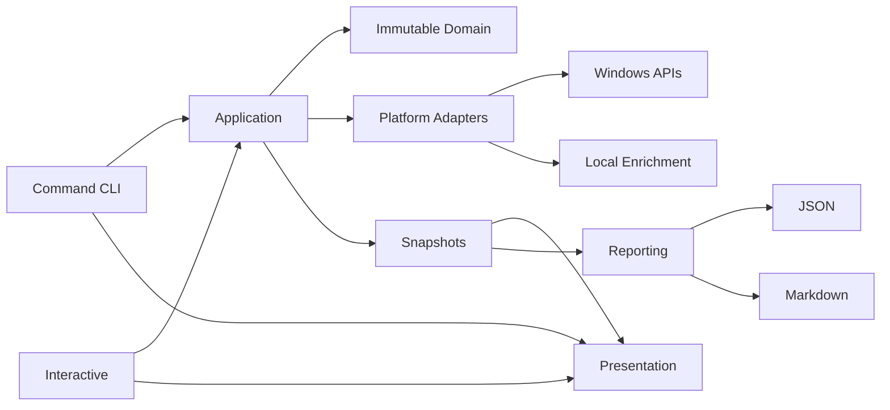

# Architecture

## System Overview

WLANScope separates user interaction, presentation, orchestration, data contracts, Windows integration, and reporting. Explicit subcommands and the interactive terminal invoke the same application use cases. Presentation renders completed models; it never collects network data. Reporting consumes a completed full snapshot; it never initiates a scan.



## Architectural Boundaries

| Boundary | Responsibility | Explicitly excluded |
| --- | --- | --- |
| CLI | `argparse` definitions, command dispatch, exit codes, and composition. | Native collection details and domain inference. |
| Interactive | Navigation, selection, refresh, cancellation, and use-case invocation. | New collection techniques and background monitoring. |
| Presentation | Theme, branding, formatting, literal-safe Rich components, and adaptive rendering. | Collection, Windows APIs, use-case execution, and domain mutation. |
| Application | Use-case orchestration, association, deterministic ordering, optional enrichment, partial outcomes, and snapshot reuse. | Native pointer ownership and terminal rendering. |
| Domain | Immutable, platform-independent models, enums, validation, and pure policies. | Subprocesses, Windows APIs, Rich, and report formats. |
| Platform | Native bindings, structured operating-system sources, wireless parsing, local enrichment, timeouts, normalization, and resource cleanup. | CLI navigation and report writing. |
| Reporting | Explicit JSON/Markdown rendering, per-export pseudonymization, and atomic local file writing. | Scanning, platform access, and snapshot mutation. |

Dependencies point inward toward domain contracts. Platform adapters return copied Python values and immutable models; raw pointers, API handles, and PowerShell transport data do not escape their owning boundary.

## Entry Points and Presentation

`wlanscope.cli` owns the command hierarchy and creates concrete use cases through `wlanscope.composition`. Explicit subcommands are deterministic and suitable for redirected output. The root command starts `InteractiveSession` only when both stdin and stdout are terminals; otherwise it prints help without prompting or clearing.

`wlanscope.presentation` is a narrow rendering package:

- `theme.py` defines semantic Rich styles and status mapping.
- `formatting.py` provides pure value formatting and compact, standard, and wide breakpoints.
- `components.py` owns literal-safe tables, headers, menus, notices, and empty states.
- `rendering.py` owns specialized current-network and full-scan compositions.
- `branding.py` owns root identity, creator/version metadata, and the static privacy note.

External strings such as SSIDs, adapter names, profiles, hostnames, vendors, issue messages, and paths become literal Rich text before rendering. Trusted labels and semantic styles remain explicit UI content. Screen clearing is gated by interactive execution, terminal detection, and an injectable test flag.

## Application and Snapshot Flow

Application services preserve one observation set as data moves through related views and stages:

1. Interface inventory is collected once and reused to associate current Wi-Fi and current-network snapshots.
2. A nearby Wi-Fi scan produces one `NearbyWifiSnapshot`; network and AP detail selections operate on it without rescanning.
3. Deduplicated AP observations are enriched as one BSSID batch through the existing local OUI resolver.
4. Device discovery consumes current routing context and produces one observed-host inventory; hostname and vendor enrichment wraps those hosts without selecting new targets.
5. `RunFullNetworkScan` executes interfaces, current Wi-Fi, current network, nearby Wi-Fi, device discovery, and enrichment sequentially, forwarding dependent results.
6. JSON and Markdown exporters consume the same `FullNetworkSnapshot`, so requesting both formats does not run a second scan.

Interactive detail views retain their current snapshot. Only an explicit Refresh invokes the relevant use case again. A full scan is point-in-time but not atomic: sections are observed sequentially and the network can change between them.

`FullNetworkSnapshot` contains timezone-aware UTC start and completion timestamps, immutable section snapshots, ordered section results, source-aware issues, and a derived overall status. Independent source failure does not erase useful results. Unknown PTR names, unknown vendors, or unavailable optional registries are normal enrichment outcomes.

## Windows Data Sources

### Native WLAN API

Native WLAN supplies interface enumeration, current association, connection attributes, radio and capability data, cumulative WLAN statistics, available networks, and BSS observations. Nearby scans use `WlanScan` and wait for interface-specific completion or failure notifications with a fixed timeout.

WLAN handles are closed and API-owned buffers are released on success and failure. SSIDs retain explicit byte length and raw bytes; safe display text is derived separately. Current WLAN interfaces associate with interface inventory only through stable GUID identity.

### IP Helper and ICMP APIs

IP Helper supplies interface rows, adapter addresses, IPv4 and IPv6 assignments, routes, metrics, DNS ordering, DHCP state, and IPv4/IPv6 neighbor information. Native tables are copied before `FreeMibTable` releases them.

Device discovery derives one local IPv4 subnet from preferred routing context. Cardinality is validated before targets are materialized: up to 256 usable addresses are allowed by default, 257 through 4,096 require explicit authorization, and larger ranges are refused. The discovery boundary combines neighbor observations with synchronous `IcmpSendEcho2` calls bounded to 750 ms and at most 32 workers. IPv6 address space is never enumerated for probing.

### Structured PowerShell and CIM

Fixed, non-interactive PowerShell scripts select explicit properties and serialize them with `ConvertTo-Json`; localized formatted tables are never parsed. Sources include NetAdapter identity and driver metadata, adapter statistics, network profiles, DNS and interface enrichment, and optional CIM DHCP lease timestamps.

PowerShell runs without a user profile or shell, does not alter execution policy, and has a fixed timeout. These sources are optional enrichment: unavailable PowerShell or CIM data cannot erase primary Native WLAN or IP Helper results.

## Local Enrichment

PTR resolution uses dnspython only for already-observed hosts, with bounded timeouts and worker count. It does not enumerate DNS zones or names.

Vendor resolution reads an optional local IEEE MA-L CSV registry. The loader validates the registry once per enrichment operation and subsequent address lookups occur in memory.

For observed hosts, globally administered MAC addresses can resolve to an assignment holder. For nearby APs, the deduplicated BSSID batch follows the same infrastructure:

```text
BSSID
  -> LocalOuiVendorResolver
  -> validated in-memory IEEE MA-L registry
  -> AP-level vendor enrichment
```

The project does not bundle or download a registry, and lookup makes no request to an external vendor service. Locally administered or multicast BSSIDs are not attributed globally. Registry absence, unknown assignments, and not-applicable addresses remain explicit without failing Nearby Wi-Fi.

## Untrusted Wireless Data

Beacon and probe-response Information Elements originate outside the endpoint and are treated as untrusted input. The BSS adapter validates fixed-entry fields, supported-rate length, entry-relative offsets, payload sizes, element headers, and declared lengths before copying or interpreting data.

The pure parser is bounded, non-recursive, deterministic, malformed-safe, and tolerant of unknown elements. It exposes selected summaries for SSID, rates, country, RSN, HT, VHT, extended capabilities, extension identifiers such as HE/EHT presence, and vendor OUIs. Unknown elements remain identifiers and counts rather than speculative fingerprints.

Passive WPS detection remains inside the same Information Element boundary:

```text
WLAN BSS entry
  -> bounded IE blob
  -> bounds-safe IE parser
  -> Vendor Specific IE 221 / 00:50:F2:04
  -> immutable WifiProtectedSetupDetails
```

WPS attributes use checked type-length-value parsing. Truncated headers, oversized lengths, conflicting duplicates, and unknown attributes cannot read beyond the copied blob or invalidate unrelated IEs. The parser consumes bytes already returned by Native WLAN; it performs no additional scan, association, packet capture, or `netsh` text parsing. Full raw WPS blobs and native pointers do not enter snapshots or reports.

## Reporting and Anonymization

Reporting maps `FullNetworkSnapshot` explicitly rather than reflecting arbitrary Python objects. JSON schema `1.0` is independent of package version. Timestamps normalize to UTC, byte-safe SSIDs retain a raw hexadecimal representation in normal reports, and Markdown escapes external values before table or inline rendering.

Normal reporting passes the immutable snapshot directly to JSON or Markdown rendering. An anonymized export inserts an ephemeral reporting context:

```text
FullNetworkSnapshot
        -> ReportAnonymizer
        -> JSON renderer
        -> Markdown renderer
```

When both formats are requested, one `ReportAnonymizer` instance is shared, so the same real identifier receives the same alias in JSON and Markdown. Mappings are deterministic by first appearance within that export operation, are never persisted, and do not mutate the snapshot. Raw forms capable of reproducing a sanitized identifier, including visible raw SSID bytes, are not retained in anonymized output.

The writer creates a UTF-8 temporary file in the destination directory, flushes and synchronizes it, then atomically renames or replaces the destination. Existing files are refused unless overwrite is explicit, missing parent directories are not created, and temporary files are removed after failure. Reporting never collects, enriches, uploads, or synchronizes data.

## Reliability and Failure Model

Collectors use explicit bounds and return source-aware outcomes. Expected access denial, unsupported fields, timeouts, malformed optional input, and unavailable enrichment become textual issues or partial sections. They are not replaced with plausible values.

The CLI maps success, operational failure, invalid usage or authorization, partial results, and cancellation to stable exit codes. Unexpected programming errors are not globally hidden. Non-TTY output does not add prompts, screen clearing, animation, or ANSI-dependent meaning.
